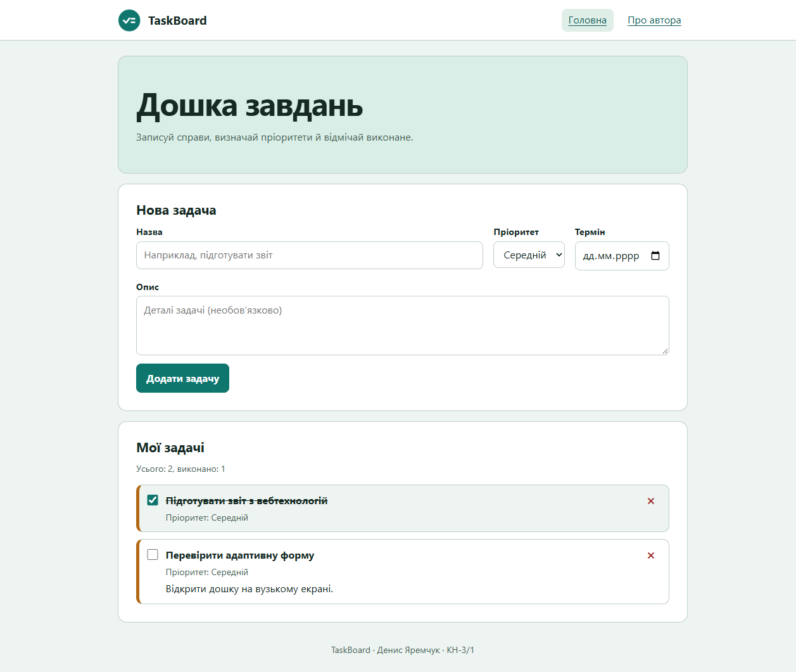

# TaskBoard

Навчальний проєкт з вебтехнологій. TaskBoard допомагає записувати справи, визначати пріоритети й контролювати виконання.

## Автор

- Денис Яремчук
- КН-3/1

## Технології

| Шар | Технології |
| --- | --- |
| Інтерфейс | HTML, CSS, JavaScript |
| Сервер | Python і Flask (заплановано) |
| База даних | SQLAlchemy і PostgreSQL (заплановано) |
| Розгортання | Docker (заплановано) |

## План розвитку

- [x] Локальний репозиторій і стартова сторінка
- [x] Семантична розмітка і сторінка автора
- [x] Адаптивна форма
- [x] Інтерактивність та локальне збереження
- [ ] Flask і база даних
- [ ] GitHub Pages

## Запуск

1. Відкрий папку проєкту у VS Code.
2. Запусти `index.html` через Live Server.

Для швидкого перегляду можна відкрити `index.html` у браузері після розпакування.

## Скріншот

## Звіт

[Практичні роботи](docs/report.md)
